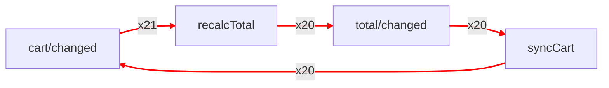

# Find and cut event loops

> **Level F.** Read first: [Trace tasks](tracing.md#attach-a-tracer). To only cut a loop, go to [`loopGuardPlugin`](loop-guard.md).

A loop is two handlers that emit each other's events, or one handler that emits its own. This page finds a loop, shows it, and stops it. Every scenario below is a runnable file in [`examples/debug`](https://github.com/nanoeffects/nanoeffects/tree/main/examples/debug), and a page with buttons and Redux DevTools is in [`examples/debug-playground`](https://github.com/nanoeffects/nanoeffects/tree/main/examples/debug-playground).

## On this page

- [Start from the symptom](#start-from-the-symptom)
- [Find a loop](#find-a-loop)
- [Read a report](#read-a-report)
- [Draw the graph](#draw-the-graph)
- [See the loop in Redux DevTools](#see-the-loop-in-redux-devtools)
- [Find a loop that no chain shows](#find-a-loop-that-no-chain-shows)
- [Break the loop](#break-the-loop)
- [Cut a loop at run time](#cut-a-loop-at-run-time)
- [Fail a test on a loop](#fail-a-test-on-a-loop)
- [Export the graph and the payloads](#export-the-graph-and-the-payloads)
- [Know how a loop is found](#know-how-a-loop-is-found)
- [Know the limits](#know-the-limits)

## Start from the symptom

| What you see | Likely cause | Go to |
| ------------ | ------------ | ----- |
| The page freezes | A loop of microtasks or a synchronous loop | [Find a loop](#find-a-loop), then [Cut a loop at run time](#cut-a-loop-at-run-time) |
| A request repeats on its own | A handler emits the event that starts it | [Read a report](#read-a-report) |
| `RangeError: Maximum call stack size exceeded` | A synchronous loop through `emit` | [Find a loop](#find-a-loop) |
| A component renders again and again | A value is sent to the bus on every render | [Find a loop that no chain shows](#find-a-loop-that-no-chain-shows) |
| You do not know which event leads to which | No map of the events | [Draw the graph](#draw-the-graph) |

## Find a loop

`graphLogger` is a trace logger. Pass it to `createTracer` like any other logger. It builds the map of which event leads to which, and writes a report once when a chain passes the same event three times. Add `tracePlugin` so that it also sees every emit and the names of your listeners. It works without the plugin, with a coarser map.

```js
// bus.js
import { createBus } from "nanoeffects";
import { createTracer, graphLogger, tracePlugin } from "nanoeffects/trace";

// graphLogger — the map of events and the loop finder, in one logger
export const graph = graphLogger({ name: "cart" });

// createTracer — sends every task of the bus to the logger
const trace = createTracer(graph);

// tracePlugin — reports every emit, so the graph also shows events that nothing listens to
export const bus = createBus({ trace }).use(tracePlugin());
```

The handlers are the part of your app that has the loop. Here a cart and a total update each other:

```js
// cart-handlers.js
import { bus } from "./bus";

// traceId — the name of the listener in the graph and in the report
bus.on(
  "cart/changed",
  (cart, ctx) => {
    ctx.emit("total/changed", cart);
  },
  { traceId: "recalcTotal" },
);

bus.on(
  "total/changed",
  (total, ctx) => {
    ctx.emit("cart/changed", total);
  },
  { traceId: "syncCart" },
);
```

`graphLogger` costs a lookup for each task. Use it while you develop, or with `createTracer(graph, { sample })` in production.

## Read a report

<!-- docs-check: continue -->

The report is one `console.warn` for each loop:

```text
[nanoeffects cart] cycle: recalcTotal → total/changed → syncCart → cart/changed → recalcTotal (repeated 3 times, started at cart/changed)
  recalcTotal at src/cart-handlers.js:6; syncCart at src/cart-handlers.js:14   (only with devPlugin)
  handlers feed each other: break the loop with a condition, or emit a different event for the result
```

- **The path** goes from the first turn of the loop back to it. A named listener shows its event before it.
- **`started at`** is the first event of the chain.
- **`at file:line`** appears when you also use [`devPlugin`](hmr.md#report-leaks-with-devplugin).
- **The last line** is advice for this shape of loop.

To receive the finding in code, pass `onCycle`. It replaces the console report:

```js
// report.js
import { graphLogger } from "nanoeffects/trace";

export const graph = graphLogger({
  // onCycle — called once for each loop; the finding has a path, the repeats and the root
  onCycle: (finding) => {
    console.error(finding.kind, finding.path.join(" → "));
  },
});
```

`graph.cycles()` lists the loops found so far, with `turns`: how many times a loop went round after it was found. It also lists cycles that no single chain showed, when the edges of different runs close a loop (`source: "graph"`).

## Draw the graph

<!-- docs-check: continue -->

The graph has a count on each edge, and the edges of a cycle are marked. Write it in the format your tool reads:

```js
// draw.js
import { graph } from "./bus";

// Mermaid: paste it into a README, a pull request or https://mermaid.live
const mermaid = graph.toMermaid({ group: "prefix" }); // group the events by the part before "/"

// Graphviz: dot -Tsvg graph.dot > graph.svg
const dot = graph.toDot();

// plain data for your own tools
const data = graph.toJSON();

console.log(mermaid, dot, data);
```



The counts (`x21`) are how many times each edge was seen; they depend on how long the loop ran.

## See the loop in Redux DevTools

`devtools: true` sends each finding to the extension as a `cycle/detected` action. Put `reduxDevtools` next to it to also see the emits:

```js
// devtools-bus.js
import { createBus } from "nanoeffects";
import { createTracer, graphLogger, reduxDevtools, tracePlugin } from "nanoeffects/trace";

// devtools: true — one cycle/detected action for each loop, with the path
const graph = graphLogger({ name: "app", devtools: true });

// reduxDevtools — the emits of the bus as actions
const trace = createTracer([reduxDevtools({ name: "app" }), graph]);

export const bus = createBus({ trace }).use(tracePlugin());
```

Redux DevTools is a browser extension, so open the page in its own tab and pick the instance in its list. Without the extension nothing is sent and nothing throws. You can try it with the buttons of [`examples/debug-playground`](https://github.com/nanoeffects/nanoeffects/tree/main/examples/debug-playground).

## Find a loop that no chain shows

Some loops have no chain of emits:

- **A component that emits on every render.** `useEmitter` and a `bus.emit` in an effect run outside any handler, so each emit is a root. `graphLogger` counts such emits for each event, and reports a **storm** when one event comes 100 times in a second. Change the limit with `storm: { count, perMs }`, or turn it off with `storm: false`.
- **A `bus.emit` inside a handler.** It starts a new chain, so the handler that calls it again does not look like a loop. Use `ctx.emit` inside handlers to keep the chain.
- **A chain of generated names** (`step/${n}`) never repeats a name. `graphLogger` reports a **runaway** chain when one root starts more than `maxSteps` tasks (5000 by default).

```js
// storm.js
import { graphLogger } from "nanoeffects/trace";

export const graph = graphLogger({
  storm: { count: 50, perMs: 1000 }, // 50 emits of one event in a second from outside
  maxSteps: 2000, // 2000 tasks started by one root
  ignore: ["tree/visit"], // a recursion on purpose is not counted
});
```

## Break the loop

| Shape | Fix |
| ----- | --- |
| A handler emits its own event | Emit a different event for the result (`user/loaded`, not `user/load`). |
| Two handlers feed each other | Add the condition that ends it, or send the result to a third event that nothing in the loop listens to. |
| A job whose outcome has the type of its trigger | Give the outcomes their own types. |
| A component emits on every render | Pass `equals` to `useEmitter`, so the same value is not an emit, or `debounce` the handler. |
| A failure re-emits the event that failed | Stop after a number of tries with `retry`, not with an event. |

## Cut a loop at run time

The report does not stop a loop. For a loop that must not take the page down, add [`loopGuardPlugin`](loop-guard.md). It refuses the emit that would pass 50 repeats, or a chain of 1000 emits, and reports it:

```js
// guarded-bus.js
import { createBus } from "nanoeffects";
import { loopGuardPlugin } from "nanoeffects/guard";
import { createTracer, graphLogger, tracePlugin } from "nanoeffects/trace";

const graph = graphLogger({ name: "app" });
const trace = createTracer(graph);

// loopGuardPlugin — cuts the loop that the graph reports
export const bus = createBus({ trace })
  .use(tracePlugin())
  .use(loopGuardPlugin({ maxRepeats: 50 }));
```

The guard is independent of the logger: use either one alone.

## Fail a test on a loop

Run a flow of the app and check that the graph has no cycle. A loop that someone adds later fails the build.

```js
// bus.js
import { createBus } from "nanoeffects";
import { createTracer, graphLogger, tracePlugin } from "nanoeffects/trace";

// the bus.js of "Find a loop": the graph logger on the tracer of the bus
export const graph = graphLogger({ name: "cart" });
export const bus = createBus({ trace: createTracer(graph) }).use(tracePlugin());
```

```js
// cart-handlers.js
import { bus } from "./bus";

bus.on("checkout/started", (_order, ctx) => {
  ctx.emit("checkout/paid");
});
```

```js
// cycles.test.js
import { expect, test } from "vitest";
import { bus, graph } from "./bus";
import "./cart-handlers";

test("the checkout flow has no event cycles", () => {
  // run the flow the way a user would
  bus.emit("checkout/started");

  // cycles() — empty when the graph has no loop
  expect(graph.cycles()).toEqual([]);
});
```

## Export the graph and the payloads

The exports leave payloads out, because a payload can hold private data. Ask for them when you need them:

```js
// bus.js
import { createBus } from "nanoeffects";
import { createTracer, graphLogger, tracePlugin } from "nanoeffects/trace";

// the bus.js of "Find a loop": the graph logger on the tracer of the bus
export const graph = graphLogger({ name: "cart" });
export const bus = createBus({ trace: createTracer(graph) }).use(tracePlugin());
```

```js
// payloads.js
import { graph } from "./bus";

// payload: true — adds the last payload and error of each node, made safe
const data = graph.toJSON({ payload: true });

console.log(JSON.stringify(data));
```

A payload can be a class instance, a `Map`, a circular object or an `Error`, which a plain `JSON.stringify` cannot take. The exports make them plain JSON: an `Error` keeps its name, message, stack and cause, a cycle becomes `"[Circular]"`, a `Map` becomes `{ "$map": [...] }`, and an instance of a class keeps its own fields and its name as `$class`. Getters are never called, and a value that is too deep or too big is cut.

## Know how a loop is found

`graphLogger` finds loops in two ways. They give two kinds of finding in `graph.cycles()`, told apart by `source`:

| | `source: "chain"` | `source: "graph"` |
| - | ----------------- | ----------------- |
| What it reads | One real run: the chain of tasks that led to the current one | Every edge seen so far, from all runs |
| The rule | The same node is in the chain `repeats` times (3 by default) | A strongly connected component of the graph (Tarjan): several nodes that reach each other, or a node that feeds itself |
| What you get | A warning, `onCycle`, DevTools, and the path | A line in `cycles()` and red edges in the exports; no warning |
| It finds | A loop that really went round | A loop that could: `a` leads to `b` in one run and `b` to `a` in another |
| It is wrong about | A recursion that ends looks like a loop after three turns | Every recursion looks like a cycle, since an event that feeds itself is a cycle of one node |

So the graph is searched, and the search is exact (no heuristic): `source: "graph"` is a real cycle of the edges. What no tool can decide is whether a cycle ever ends. A tree walk that emits `tree/visit` for each child is a cycle in the graph and in the chain, and it ends. The only evidence that separates a loop from such a recursion is how often it repeats, which is why the chain finding has a threshold (`repeats`) and why you tell the logger about recursion on purpose with `ignore` ([below](#code-that-repeats-on-purpose-looks-like-a-loop)). For a loop that must be stopped, not found, use [`loopGuardPlugin`](loop-guard.md): it cuts a chain at a limit and does not need to decide.

```js
// source.js
import { graphLogger } from "nanoeffects/trace";

const graph = graphLogger();

for (const cycle of graph.cycles()) {
  // "chain": it ran as one chain (and was reported); "graph": the edges of different runs close it
  console.log(cycle.source, cycle.path.join(" → "));
}
```

## Know the limits

### Code that repeats on purpose looks like a loop

`graphLogger` calls it a loop when one event stands in a chain three times. Some code does that by design. A handler that walks a tree emits `tree/visit` for every child, so the same event is in the chain once for each level. The logger cannot tell this from a mistake, so it reports it.

Tell it with `ignore`. The event stays in the graph and in the exports, but it is not counted as a repeat, a step, or a storm:

```js
// graph.js
import { graphLogger } from "nanoeffects/trace";

export const graph = graphLogger({
  // tree/visit repeats once for each level of the tree, on purpose
  ignore: ["tree/visit"],
});
```

Do not list an event only to silence a real loop: the report is the point. `ignore` also takes a function of the name, `ignore: (name) => name.startsWith("tree/")`.

### A loop is reported once, and keeps being counted

A loop that runs 500 turns writes one warning, not 500. After the warning, the logger counts the turns quietly. Read the count from `graph.cycles()` to see whether the loop is still going:

```js
// turns.js
import { graph } from "./graph";

const [loop] = graph.cycles();

// turns — how many times the loop has gone round since it was found, the first time included
console.log(loop.path.join(" → "), loop.turns);
```

Read it twice a moment apart. A number that grew means the loop is still running. The same number means it stopped. To act on the first report in code, use `onCycle`; it is called once too.

### Without tracePlugin the graph is coarser

Without `tracePlugin` the logger sees handlers but not the emits that nobody listens to, and it cannot give a name to a listener. A loop is still found, by event type.
