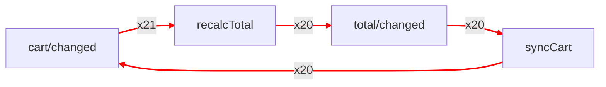

# Поиск и обрыв циклов событий

> **[Уровень F](README.md#виды-проектов)**: платформа, SDK или долгоживущее приложение. Сначала прочитайте: [Трассировка задач](tracing.md#подключение-трассировщика). Чтобы только оборвать цикл, перейдите к [`loopGuardPlugin`](loop-guard.md).

Цикл — это два обработчика, которые отправляют события друг друга, или один, который отправляет своё же. На этой странице цикл находят, показывают и останавливают. Каждый сценарий ниже — запускаемый файл в [`examples/debug`](https://github.com/nanoeffects/nanoeffects/tree/main/examples/debug), а страница с кнопками и Redux DevTools лежит в [`examples/debug-playground`](https://github.com/nanoeffects/nanoeffects/tree/main/examples/debug-playground).

## На этой странице

- [Симптомы](#симптомы)
- [Поиск цикла](#поиск-цикла)
- [Чтение отчёта](#чтение-отчёта)
- [Построение графа](#построение-графа)
- [Цикл в Redux DevTools](#цикл-в-redux-devtools)
- [Цикл без цепочки](#цикл-без-цепочки)
- [Разрыв цикла](#разрыв-цикла)
- [Обрыв цикла во время работы](#обрыв-цикла-во-время-работы)
- [Падение теста при цикле](#падение-теста-при-цикле)
- [Экспорт графа и payload](#экспорт-графа-и-payload)
- [Ограничения](#ограничения)

## Симптомы

| Что вы видите | Вероятная причина | Куда перейти |
| ------------- | ----------------- | ------------ |
| Страница зависает | Цикл из микрозадач или синхронный цикл | [Поиск цикла](#поиск-цикла), затем [Обрыв цикла во время работы](#обрыв-цикла-во-время-работы) |
| Запрос повторяется сам | Обработчик отправляет событие, которое его запускает | [Чтение отчёта](#чтение-отчёта) |
| `RangeError: Maximum call stack size exceeded` | Синхронный цикл через `emit` | [Поиск цикла](#поиск-цикла) |
| Компонент рендерится снова и снова | Значение отправляется на шину на каждом рендере | [Цикл без цепочки](#цикл-без-цепочки) |
| Непонятно, какое событие к какому ведёт | Нет карты событий | [Построение графа](#построение-графа) |

## Поиск цикла

`graphLogger` — логгер трассировки. Передайте его в `createTracer`, как любой другой. Он строит карту того, какое событие к какому ведёт, и один раз пишет отчёт, когда цепочка проходит через одно и то же событие три раза. Добавьте `tracePlugin`, чтобы он видел и каждый emit, и имена ваших подписок. Без плагина он тоже работает, но карта грубее.

```js
// bus.js
import { createBus } from "nanoeffects";
import { createTracer, graphLogger, tracePlugin } from "nanoeffects/trace";

// graphLogger — карта событий и поиск циклов в одном логгере
export const graph = graphLogger({ name: "cart" });

// createTracer — передаёт логгеру каждую задачу шины
const trace = createTracer(graph);

// tracePlugin — сообщает о каждом emit, поэтому в графе есть и события, которые никто не слушает
export const bus = createBus({ trace }).use(tracePlugin());
```

Обработчики — это часть вашего приложения, где есть цикл. Здесь корзина и итог обновляют друг друга:

```js
// cart-handlers.js
import { bus } from "./bus";

// traceId — имя подписки в графе и в отчёте
bus.on(
  "cart/changed",
  (cart, ctx) => {
    ctx.emit("total/changed", cart);
  },
  { traceId: "recalcTotal" },
);

bus.on(
  "total/changed",
  (total, ctx) => {
    ctx.emit("cart/changed", total);
  },
  { traceId: "syncCart" },
);
```

`graphLogger` стоит одного поиска на каждую задачу. Включайте его при разработке или в production вместе с `createTracer(graph, { sample })`.

## Чтение отчёта

<!-- docs-check: continue -->

Отчёт — одна строка `console.warn` на каждый цикл:

```text
[nanoeffects cart] cycle: recalcTotal → total/changed → syncCart → cart/changed → recalcTotal (repeated 3 times, started at cart/changed)
  recalcTotal at src/cart-handlers.js:6; syncCart at src/cart-handlers.js:14   (only with devPlugin)
  handlers feed each other: break the loop with a condition, or emit a different event for the result
```

- **Путь** идёт от первого витка цикла обратно к нему. У именованной подписки перед ней показано её событие.
- **`started at`** — первое событие цепочки.
- **`at файл:строка`** появляется, если вы используете и [`devPlugin`](hmr.md#сообщения-об-утечках-через-devplugin).
- **Последняя строка** — совет для такой формы цикла.

Чтобы получить находку в коде, передайте `onCycle`. Он заменяет отчёт в консоли:

```js
// report.js
import { graphLogger } from "nanoeffects/trace";

export const graph = graphLogger({
  // onCycle — вызывается один раз на каждый цикл; в находке есть путь, повторы и корень
  onCycle: (finding) => {
    console.error(finding.kind, finding.path.join(" → "));
  },
});
```

`graph.cycles()` перечисляет найденные циклы и `turns`: сколько раз цикл прошёл после обнаружения. В списке есть и циклы, которых не показала ни одна цепочка, когда петлю замыкают рёбра разных запусков (`source: "graph"`).

## Построение графа

<!-- docs-check: continue -->

В графе у каждого ребра есть счётчик, а рёбра цикла отмечены. Запишите его в формате, который читает ваш инструмент:

```js
// draw.js
import { graph } from "./bus";

// Mermaid: вставьте в README, в pull request или на https://mermaid.live
const mermaid = graph.toMermaid({ group: "prefix" }); // события группируются по части имени до "/"

// Graphviz: dot -Tsvg graph.dot > graph.svg
const dot = graph.toDot();

// обычные данные для ваших инструментов
const data = graph.toJSON();

console.log(mermaid, dot, data);
```



Счётчики (`x21`) — сколько раз видели каждое ребро; они зависят от того, как долго шёл цикл.

## Цикл в Redux DevTools

`devtools: true` отправляет каждую находку в расширение как действие `cycle/detected`. Добавьте рядом `reduxDevtools`, чтобы видеть и emit:

```js
// devtools-bus.js
import { createBus } from "nanoeffects";
import { createTracer, graphLogger, reduxDevtools, tracePlugin } from "nanoeffects/trace";

// devtools: true — одно действие cycle/detected на каждый цикл, с путём
const graph = graphLogger({ name: "app", devtools: true });

// reduxDevtools — emit шины в виде действий
const trace = createTracer([reduxDevtools({ name: "app" }), graph]);

export const bus = createBus({ trace }).use(tracePlugin());
```

Redux DevTools — расширение браузера, поэтому откройте страницу в отдельной вкладке и выберите экземпляр в его списке. Без расширения ничего не отправляется и ничего не падает. Попробовать можно на кнопках [`examples/debug-playground`](https://github.com/nanoeffects/nanoeffects/tree/main/examples/debug-playground).

## Цикл без цепочки

У некоторых циклов нет цепочки emit:

- **Компонент, который отправляет событие на каждом рендере.** `useEmitter` и `bus.emit` в эффекте работают вне обработчиков, поэтому каждый emit — корень. `graphLogger` считает такие emit для каждого события и сообщает о **шторме**, когда одно событие приходит 100 раз за секунду. Предел меняется через `storm: { count, perMs }`, а `storm: false` отключает проверку.
- **`bus.emit` внутри обработчика.** Он начинает новую цепочку, поэтому обработчик, который вызывает его снова, не похож на цикл. Внутри обработчиков используйте `ctx.emit`, чтобы цепочка сохранялась.
- **Цепочка из сгенерированных имён** (`step/${n}`) не повторяет имя. `graphLogger` сообщает о **runaway**-цепочке, когда один корень запускает больше `maxSteps` задач (по умолчанию 5000).

```js
// storm.js
import { graphLogger } from "nanoeffects/trace";

export const graph = graphLogger({
  storm: { count: 50, perMs: 1000 }, // 50 emit одного события за секунду извне
  maxSteps: 2000, // 2000 задач, запущенных одним корнем
  ignore: ["tree/visit"], // намеренная рекурсия не считается
});
```

## Разрыв цикла

| Форма | Исправление |
| ----- | ----------- |
| Обработчик отправляет своё же событие | Отправляйте для результата другое событие (`user/loaded`, а не `user/load`). |
| Два обработчика кормят друг друга | Добавьте условие, которое прекращает цикл, или отправьте результат в третье событие, которое в цикле никто не слушает. |
| Job, у которого исход имеет тип триггера | Дайте исходам собственные типы. |
| Компонент отправляет событие на каждом рендере | Передайте `equals` в `useEmitter`, чтобы то же значение не было emit, либо добавьте `debounce` обработчику. |
| Сбой повторно отправляет событие, которое упало | Ограничивайте число попыток через `retry`, а не событием. |

## Обрыв цикла во время работы

Отчёт цикл не останавливает. Если цикл не должен ронять страницу, добавьте [`loopGuardPlugin`](loop-guard.md). Он отклоняет emit, который превысил бы 50 повторов или цепочку из 1000 emit, и сообщает об этом:

```js
// guarded-bus.js
import { createBus } from "nanoeffects";
import { loopGuardPlugin } from "nanoeffects/guard";
import { createTracer, graphLogger, tracePlugin } from "nanoeffects/trace";

const graph = graphLogger({ name: "app" });
const trace = createTracer(graph);

// loopGuardPlugin — обрывает цикл, о котором сообщает граф
export const bus = createBus({ trace })
  .use(tracePlugin())
  .use(loopGuardPlugin({ maxRepeats: 50 }));
```

Предохранитель не зависит от логгера: используйте любой из них отдельно.

## Падение теста при цикле

Запустите сценарий приложения и проверьте, что в графе нет цикла. Цикл, который кто-то добавит позже, уронит сборку.

```js
// bus.js
import { createBus } from "nanoeffects";
import { createTracer, graphLogger, tracePlugin } from "nanoeffects/trace";

// bus.js из раздела «Поиск цикла»: логгер графа на трассировщике шины
export const graph = graphLogger({ name: "cart" });
export const bus = createBus({ trace: createTracer(graph) }).use(tracePlugin());
```

```js
// cart-handlers.js
import { bus } from "./bus";

bus.on("checkout/started", (_order, ctx) => {
  ctx.emit("checkout/paid");
});
```

```js
// cycles.test.js
import { expect, test } from "vitest";
import { bus, graph } from "./bus";
import "./cart-handlers";

test("the checkout flow has no event cycles", () => {
  // запустите сценарий так, как это сделал бы пользователь
  bus.emit("checkout/started");

  // cycles() — пуст, если в графе нет цикла
  expect(graph.cycles()).toEqual([]);
});
```

## Экспорт графа и payload

Экспорт не включает payload, потому что в нём могут быть личные данные. Запросите их, когда они нужны:

```js
// bus.js
import { createBus } from "nanoeffects";
import { createTracer, graphLogger, tracePlugin } from "nanoeffects/trace";

// bus.js из раздела «Поиск цикла»: логгер графа на трассировщике шины
export const graph = graphLogger({ name: "cart" });
export const bus = createBus({ trace: createTracer(graph) }).use(tracePlugin());
```

```js
// payloads.js
import { graph } from "./bus";

// payload: true — добавляет последний payload и ошибку каждого узла в безопасном виде
const data = graph.toJSON({ payload: true });

console.log(JSON.stringify(data));
```

Payload может быть экземпляром класса, `Map`, объектом с циклической ссылкой или `Error`, которые обычный `JSON.stringify` не примет. Экспорт превращает их в обычный JSON: у `Error` остаются имя, сообщение, стек и причина, цикл становится `"[Circular]"`, `Map` — `{ "$map": [...] }`, а экземпляр класса сохраняет собственные поля и имя класса в `$class`. Геттеры не вызываются, а слишком глубокое или слишком большое значение обрезается.

## Ограничения

### Намеренный повтор выглядит как цикл

`graphLogger` считает циклом событие, которое встретилось в одной цепочке три раза. Некоторый код делает так намеренно. Обработчик, который обходит дерево, отправляет `tree/visit` для каждого потомка, поэтому одно и то же событие стоит в цепочке по разу на каждый уровень. Отличить это от ошибки логгер не может, поэтому сообщает о цикле.

Скажите ему об этом через `ignore`. Событие остаётся в графе и в экспорте, но не считается ни повтором, ни шагом, ни штормом:

```js
// graph.js
import { graphLogger } from "nanoeffects/trace";

export const graph = graphLogger({
  // tree/visit повторяется на каждом уровне дерева намеренно
  ignore: ["tree/visit"],
});
```

Не добавляйте событие в список только ради тишины при настоящем цикле: отчёт нужен именно для него. `ignore` принимает и функцию от имени: `ignore: (name) => name.startsWith("tree/")`.

### О цикле сообщается один раз, но он продолжает считаться

Цикл на 500 оборотов пишет одно предупреждение, а не 500. После предупреждения логгер молча считает обороты. Чтобы узнать, идёт ли цикл до сих пор, прочитайте счётчик из `graph.cycles()`:

```js
// turns.js
import { graph } from "./graph";

const [loop] = graph.cycles();

// turns — сколько раз цикл прошёл с момента обнаружения, первый раз включительно
console.log(loop.path.join(" → "), loop.turns);
```

Прочитайте его дважды с паузой. Если число выросло, цикл ещё идёт. Если осталось тем же, он остановился. Чтобы отреагировать на первое сообщение в коде, используйте `onCycle`: он тоже вызывается один раз.

### Без tracePlugin граф грубее

Без `tracePlugin` логгер видит обработчики, но не видит emit, которые никто не слушает, и не может назвать подписку. Цикл всё равно находится, по типу события.
